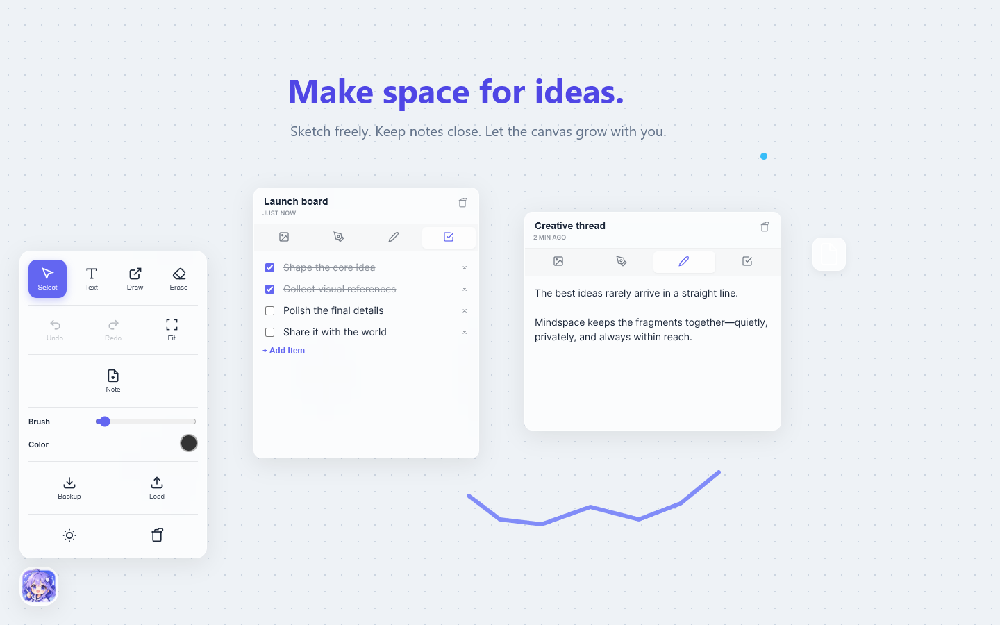
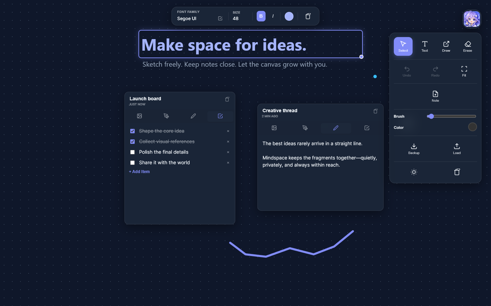

<p align="center">
  
</p>

<p align="center">
  
</p>

<h1 align="center">Mindspace: Infinite Canvas</h1>

<p align="center">
  A private, offline whiteboard that turns every new tab into room for ideas.
</p>

<p align="center">
  <a href="https://github.com/DopaLab/mindspace-infinite-canvas/releases/latest"></a>
  <a href="LICENSE"></a>
  <a href="https://github.com/DopaLab/mindspace-infinite-canvas/actions/workflows/validate.yml"></a>
  <a href="https://ko-fi.com/fgtranime"></a>
</p>

Mindspace is a lightweight Manifest V3 extension for Chrome and Edge. It replaces the new-tab page with an infinite, zoomable canvas for freehand sketches, formatted text, images, links, multi-mode notes, and task lists. Everything stays on your device unless you explicitly export a backup.

## Screenshots

### Light canvas



### Dark canvas



<p align="center">
  
</p>

## Highlights

- **Infinite visual workspace** — pan with Space-drag or the middle mouse button and zoom around the pointer.
- **Flexible building blocks** — add text, pasted images, links, drawings, checklists, notes, and mini sketchpads.
- **Edge-aware floating tools** — drag the mascot orb anywhere; its palette flips, clamps, and scrolls to remain usable at every edge and corner.
- **Safe creative flow** — undo and redo up to 60 recent board changes, duplicate elements, bring items forward, or fit everything on screen.
- **Local fonts** — optionally browse and use fonts installed on your computer when the browser supports Local Font Access.
- **Portable backups** — export a readable JSON backup and restore it later with validation and content sanitization.
- **Theme-aware drawing** — real transparent erasing works consistently in light and dark mode.
- **Private by design** — no account, analytics, ads, tracking, or remote application server.

## Install

### Download the release

1. Download `Mindspace-Infinite-Canvas-v4.0.0.zip` from the [latest release](https://github.com/DopaLab/mindspace-infinite-canvas/releases/latest).
2. Extract the ZIP to a permanent folder.
3. Open `edge://extensions` in Microsoft Edge or `chrome://extensions` in Google Chrome.
4. Enable **Developer mode**.
5. Choose **Load unpacked** and select the extracted folder.
6. Open a new tab.

The browser will warn that Mindspace changes the new-tab page because that is its core purpose.

### Install from source

```powershell
git clone https://github.com/DopaLab/mindspace-infinite-canvas.git
```

Then load the cloned folder as an unpacked extension. There is no build step and no runtime dependency.

## Controls

| Action | Control |
|---|---|
| Select | `V` |
| Add text | `T` |
| Draw | `P` |
| Erase | `E` |
| Pan | Hold `Space` and drag, or middle-mouse drag |
| Zoom | `Ctrl`/`⌘` + mouse wheel while selecting; mouse wheel while drawing |
| Undo | `Ctrl`/`⌘` + `Z` |
| Redo | `Ctrl`/`⌘` + `Shift` + `Z`, or `Ctrl` + `Y` |
| Duplicate selection | `Ctrl`/`⌘` + `D` |
| Fit all content | `0` |
| Delete selection | `Delete` or `Backspace` |
| Exit a tool / clear selection | `Esc` |

Right-click the canvas to paste, add a note, or clear the board. Right-click an element for actions such as duplicate, copy, expand, open, bring to front, or delete.

## Notes

Each note is a compact workspace with four modes:

- Image attachment
- Mini drawing canvas
- Freeform text
- Checklist

Resize and move notes like any other board element. Their contents are included in backups.

## Privacy and permissions

Mindspace stores board data in the browser's local IndexedDB database. It does not send board contents, clipboard data, font information, or usage telemetry to a server. See the complete [privacy policy](PRIVACY.md).

| Permission | Why it is used |
|---|---|
| `unlimitedStorage` | Lets image-rich boards grow beyond the browser's small default storage quota. |
| `clipboardRead` | Enables the explicit **Paste from Clipboard** canvas action. |
| `clipboardWrite` | Enables explicit copy actions for board text and images. |
| `favicon` | Displays browser-provided favicons for pasted links without broad website access. |

Mindspace requests no host permissions and cannot read arbitrary webpages.

## Backups

Use **Backup** in the floating palette before large changes or moving the extension between profiles. Restoring a backup replaces the current board only after confirmation. Imported data is type-checked, bounded, and sanitized before rendering.

## Development

The extension is plain HTML, CSS, and JavaScript:

```text
manifest.json   Manifest V3 configuration
newtab.html     Accessible application shell
styles.css      Light/dark glass UI and responsive panels
script.js       Canvas, widgets, persistence, history, and import/export
icons/          Browser icon sizes
docs/assets/    README artwork and real product screenshots
```

Run the repository checks with:

```powershell
node scripts/validate.mjs
```

Create a release ZIP and checksum on Windows with:

```powershell
powershell -ExecutionPolicy Bypass -File scripts/package.ps1
```

The included GitHub Actions workflow runs the same validation on every push and pull request.

## Limitations

- Designed for current Chromium-based browsers, with Microsoft Edge and Google Chrome as the supported targets.
- Boards are local to a browser profile; automatic device sync and collaboration are intentionally not included.
- Local Font Access support and permission behavior depend on the browser and operating system.
- Very large embedded images can make backup files large even though storage is not artificially capped.

## Support the project

If Mindspace helps you think more clearly, you can support continued development on [Ko-fi](https://ko-fi.com/fgtranime).

<p align="center">
  <a href="https://ko-fi.com/fgtranime"></a>
</p>

## License

Mindspace is released under the [MIT License](LICENSE).

The mascot and promotional artwork were created specifically for Mindspace. Product screenshots show the actual extension UI with illustrative demo content.
